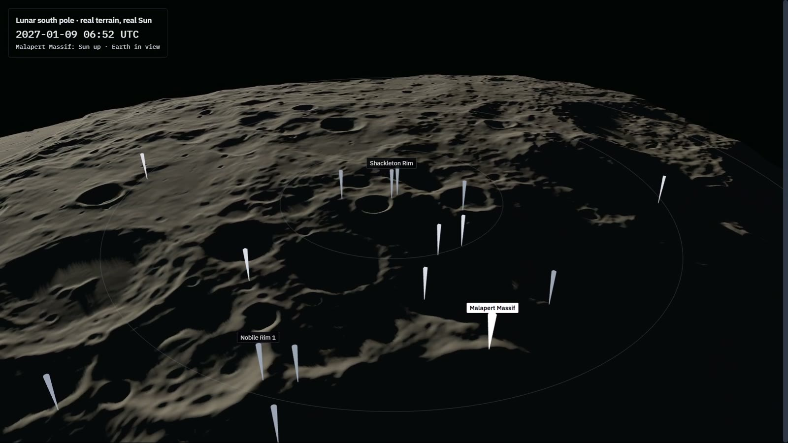
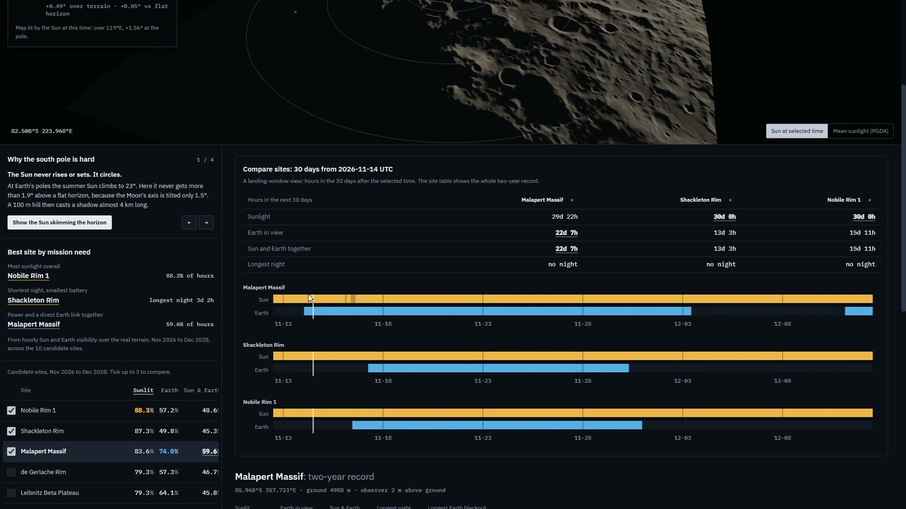
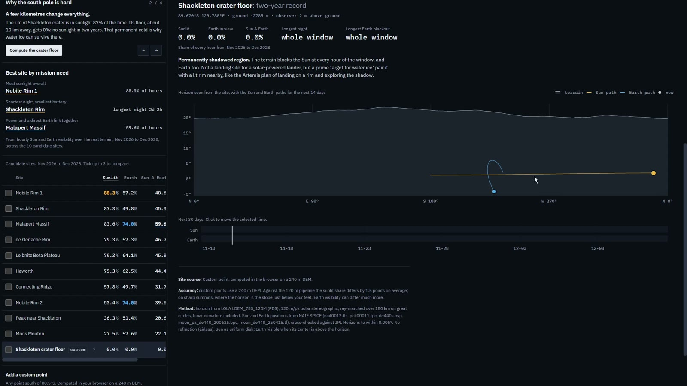
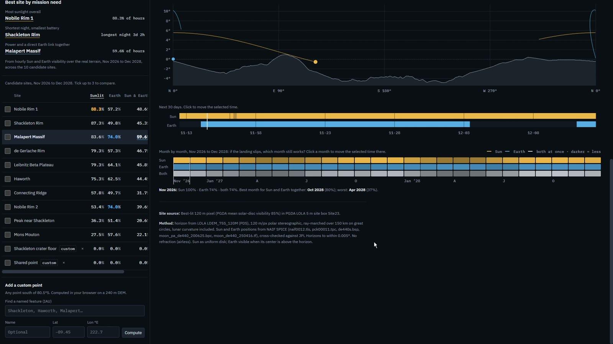

<div align="center">

# 🌑 Lunar Landing Site Navigator

**Where, and when, can a lander see the Sun and the Earth near the lunar south pole?**

Real NASA terrain · real ephemerides · every hour from Nov 2026 to Dec 2028

[**▶ Open the app**](https://marcelin1555.github.io/lunar-landing-site-navigator/) ·
[**🎬 30 s demo**](https://youtu.be/x8fPTm4psCg) ·
[Cinematic view](https://marcelin1555.github.io/lunar-landing-site-navigator/?film) ·
[Validation](docs/validation.md)

*Team Quiral Labs · NASA Space Apps Challenge 2026 · Lunar Landing Site Navigator*



</div>

Near the lunar south pole the Sun never climbs more than a couple of degrees above a flat horizon, and Earth wobbles above and below it. A hill 10 km away can decide whether a lander has power or a direct link home. This app computes the **real terrain horizon** of each candidate site and shows, hour by hour, when the Sun and the Earth are above it. Mission planners can compare sites by:
- hours of sunlight (power),
- Earth visibility (direct communication),
- the longest stretch of darkness.

Students and the public get a four-step tour, "Why the south pole is hard", described below.

## At a glance

Results for the 2026–2028 window (share of all hours, from the app's own output):

| Site | Sun | Earth in view | Sun **and** Earth | Longest night |
|---|---:|---:|---:|---:|
| Nobile Rim 1 | **88.3%** | 57.2% | 48.6% | 10 d 3 h |
| Shackleton Rim | 87.3% | 49.8% | 45.3% | **3 d 2 h** |
| Malapert Massif | 83.6% | **74.0%** | **59.6%** | 11 d 0 h |
| Shackleton crater floor (10 km from the rim) | 0% | 0% | 0% | whole window |

More sunlight is not always a better site: Shackleton Rim is sunlit more of the time than Malapert, but Malapert gives far more hours with a direct link to Earth. For a landing on 14 Nov 2026, Malapert has 22 days of Sun and Earth together in the next 30, against 13 for Shackleton Rim.

<table>
<tr>
<td width="50%"><br><sub><b>Compare up to three sites</b> for the next 30 days from any date.</sub></td>
<td width="50%"><br><sub><b>A few kilometres change everything.</b> The crater floor sees a 20° wall: 0% Sun, 0% Earth.</sub></td>
</tr>
<tr>
<td colspan="2" align="center"><br><sub><b>If the launch slips,</b> which month still works? The month-by-month strip answers it.</sub></td>
</tr>
</table>

## Try it in 30 seconds

| Link | What it shows |
|---|---|
| [`/`](https://marcelin1555.github.io/lunar-landing-site-navigator/) | The winner of the Sun-and-Earth verdict, Malapert Massif, with the tour and all 10 sites |
| [`#shackleton-rim`](https://marcelin1555.github.io/lunar-landing-site-navigator/#shackleton-rim) | Any site by its id |
| [`#at=-89.67,129.78`](https://marcelin1555.github.io/lunar-landing-site-navigator/#at=-89.67,129.78) | Any point south of 80.5°S, computed in your browser |
| [`?cmp=malapert-massif,shackleton-rim,nobile-rim-1`](https://marcelin1555.github.io/lunar-landing-site-navigator/?cmp=malapert-massif,shackleton-rim,nobile-rim-1) | A comparison, shareable as a link |
| [`?film`](https://marcelin1555.github.io/lunar-landing-site-navigator/?film) | Cinematic mode: full-screen terrain, slow orbit, time running |

## Contents

[How it works](#how-it-works) · [For students and the public](#for-students-and-the-public) · [Validation](#validation) · [Limitations](#limitations) · [Run](#run) · [Use of AI](#use-of-ai) · [References](#references)

## How it works

1. **Horizon.** From each site we cast 720 rays, one every 0.5° of azimuth, out to 150 km along great circles. The rays run over the LOLA polar elevation model. For each direction we keep the highest terrain elevation angle, computed with exact 3D geometry so the Moon's curvature is included. The observer stands 2 m above the ground.
2. **Sun and Earth.** Azimuth and elevation come from NASA/NAIF SPICE, every hour, in the MOON_ME frame with light-time and aberration correction.
3. **Visibility.**
   - Sun: the fraction of the solar disk above the local horizon.
   - Earth: whether its center is above the horizon.
4. **Summaries.** For each site: % of time sunlit, % of time with Earth in view, % with both, longest night, and longest Earth blackout.

The pipeline (`pipeline/`, Python) writes one JSON file per site. The web app (`web/`, Svelte + D3 + three.js) is static and only reads those files.

**Any point, in the browser.** Click the 3D terrain, type coordinates, or search an IAU feature name. The browser then repeats the same math on a 240 m tiled DEM, using Sun and Earth vectors precomputed with SPICE. It loads only the tiles around the point and takes about 0.2 s. `web/scripts/validate-free.ts` checks it against the 10 pipeline sites:
- Sun and Earth paths match exactly.
- Sunlit share differs by 1.5 points on average.

**Month by month.** For the selected site the app shows every calendar month from November 2026 to December 2028, with the share of hours with Sun, with Earth and with both. Click a month to move there. This answers the schedule question: if the landing slips, which month still works? At Malapert Massif, for example, Sun and Earth together range from 37% of hours (April 2028) to 80% (October 2028).

On sharp summits the horizon is the slope just below the observer, so Earth visibility there is sensitive to DEM resolution. The app says so.

Crater floors such as Shackleton, Haworth and Faustini come out at 0% Sun and 0% Earth. These are permanently shadowed regions, where water ice may be.

## For students and the public

The tour at the top of the site list explains in four steps why the south pole is so unlike Earth. Each step has a "Show me" button that puts the app in the state that proves the point:

1. **The Sun circles instead of rising and setting.** It never gets more than 1.9° above a flat horizon at Shackleton's rim (vs 23° at Earth's poles in summer), so a 100 m hill casts a shadow almost 4 km long. The button opens the horizon chart.
2. **A few kilometres change everything.** Shackleton's rim is sunlit 87% of the time; its floor, about 10 km away, 0%. The button computes the floor.
3. **Earth hides too.** On the rim Earth is in view half the time, with blackouts of up to 14 days; Malapert sees it 74% of the time. The button opens the visibility timeline.
4. **Nights last days.** The longest night is 3 days on Shackleton's rim and 11 days at Malapert. The button plays a lunar day.

Every number comes from the app's own 2026–2028 results.

## Validation

- Sun and Earth azimuth and elevation match **JPL Horizons** to within 0.005°. The values are fixed in `pipeline/tests/test_ephemeris.py`.
- The horizon code is tested against two exact cases: a smooth sphere, where the expected value is the geometric dip, and a wall of known height and distance.
- Site averages are compared with the PGDA average solar-visibility maps (Mazarico et al. 2011). See `docs/validation.md`.

## Limitations

- At 120 m per pixel the DEM smooths small nearby relief. The PGDA 5 m maps are a possible upgrade.
- There is no atmosphere, so no refraction. The Sun is modeled as a uniform disk.
- Earth counts as visible when its center is above the terrain. Real links also depend on antenna height and relays.
- Energy is shown as hours of sunlight, not watts.
- Coverage is the south polar region (south of 80.5°S for custom points). Equatorial sites such as the Apollo landings are out of scope; the pole is where terrain makes the problem hardest.
- The 3D view is a visual guide. It uses a 1.2 km mesh at true scale and true curvature, lit from the real Sun direction (SPICE) with a shadow map. Every number in the app comes from the 120 m analysis (240 m for custom points), not from the 3D rendering.

## Run

```bash
cd pipeline && python -m pytest -q          # tests
python sites.py                              # site list (needs network)
python export.py                             # writes web/public/data/*.json
cd ../web && npm install && npm run dev
```

The data files go in `data/raw/ldem_75s_120m.img` and `data/kernels/`. See References for the URLs.

## Use of AI

AI assistance (Claude, by Anthropic) was used for research, architecture discussion, generating and reviewing code, and translating the written submission from Portuguese to English.

- **Code:** much of the code in `pipeline/` and `web/` was generated with an AI assistant (Claude Code) from the author's specifications, then reviewed, tested and validated against NASA references (JPL Horizons and PGDA maps).
- **Demo video:** a screen recording of the real app, cut and subtitled with Remotion and ffmpeg. No narration.
- **Images:** the screenshots in this README are frames from those recordings. No images, video or audio were generated by AI.
- **Decisions:** the author made every design decision, validated the data, and did the final review.

## References

**NASA data**
- LOLA polar DEM `LDEM_75S_120M`, PDS Geosciences Node: https://pds-geosciences.wustl.edu/lro/lro-l-lola-3-rdr-v1/lrolol_1xxx/data/lola_gdr/polar/
- PGDA average solar-visibility maps (product 69): https://pgda.gsfc.nasa.gov/products/69. Mazarico et al. 2011, Icarus 211, doi:10.1016/j.icarus.2010.10.030.
- PGDA LOLA 5 m/px site boxes, used to place sites: https://pgda.gsfc.nasa.gov/data/LOLA_5mpp/. Barker et al. 2021, PSS 203, doi:10.1016/j.pss.2020.105119.
- NAIF SPICE generic kernels (de440s, moon_pa_de440_200625, moon_de440_250416, pck00011, naif0012): https://naif.jpl.nasa.gov/pub/naif/generic_kernels/
- JPL Horizons API, used for validation: https://ssd.jpl.nasa.gov/horizons/

- PGDA mean solar visibility map `AVGVISIB_75S_120M_201608`, used to color the 3D terrain.
- IAU Gazetteer of Planetary Nomenclature (USGS), lunar center points: https://planetarynames.wr.usgs.gov/GIS_Downloads

**Site coordinates**
- LPSC 2024 abstract #1695: Connecting Ridge, Peak near Shackleton.
- LPSC 2025 abstract #2742: Mons Mouton.

**Software**
- NumPy, SciPy, SpiceyPy, rasterio and GDAL, pytest.
- Svelte, Vite, D3, three.js.
- IBM Plex fonts (SIL OFL), via Fontsource.
